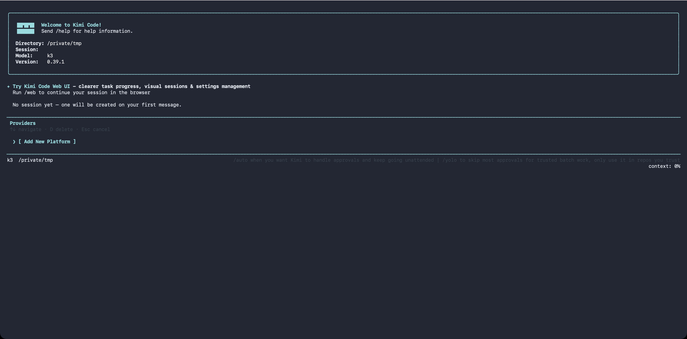

# Providers and models

Kimi Code CLI supports connecting to multiple LLM platforms simultaneously: one-click login via the Kimi Code managed service, connecting Claude with an Anthropic API key, or connecting third-party inference services via the OpenAI-compatible protocol. Each provider corresponds to a specific API protocol; models are declared on top of providers with their own name, context length, and capabilities. This page explains how to configure each type of provider in `config.toml`.

## Supported provider types

The `type` field in the `providers` table determines which protocol implementation to use:

| Type | Protocol | Typical use |
| --- | --- | --- |
| [`kimi`](#kimi) | OpenAI-compatible | Kimi Code managed service, Kimi Platform API key |
| [`anthropic`](#anthropic) | Anthropic Messages | Claude model family |
| [`openai`](#openai) | OpenAI Chat Completions | OpenAI and compatible services, DeepSeek, Qwen, etc. |
| [`openai_responses`](#openai-responses) | OpenAI Responses API | OpenAI's newer Responses interface |
| [`google-genai`](#google-genai) | Google GenAI | Gemini API |
| [`vertexai`](#vertexai) | Google GenAI on Vertex | Google Cloud Vertex AI |

All providers communicate with models in streaming mode by default. Capabilities such as thinking, vision, and tool use are matched automatically by model name prefix, so you typically do not need to declare them manually.

**Credential priority**: `api_key` or `api_key_env` (mutually exclusive alternatives — set exactly one) > `[providers.<name>.env]` sub-table key (only when neither is present) > if all are absent, startup fails with an error. Except for the explicitly declared `api_key_env`, the CLI does not fall back to shell environment variables for credentials. See [Config overrides: provider credentials](./overrides.md#provider-credentials).

## `/provider` — interactive provider management

Prefer not to edit TOML by hand? Type `/provider` in the TUI to open the **provider manager**, where you can interactively add, edit or remove providers.



The manager displays providers as a list of entries grouped by source. Navigation:

- ↑/↓ to move the cursor, ←/→ to page
- `E` to edit the current provider, renaming included
- `d` to delete the current provider (with `[y/N]` confirmation)
- Press Enter on the `[ Add New Platform ]` row to add a new provider

Two import paths when adding (the third is manual entry, covered in the next section):

- **Known third-party provider**: fetches the model catalog from [models.dev](https://models.dev/), select a provider → enter an API key → select a default model. Vendors whose protocol the catalog does not declare (e.g. xai, openrouter, and other vendor-specific SDKs) are imported as OpenAI-compatible with a "guessed" note; when the catalog provides no usable endpoint, a base URL prompt appears first; proprietary protocols (Amazon Bedrock, Cohere) and unrecognized explicit protocols are refused. Deprecated and alpha-status models are excluded from the import list. If the public catalog is unreachable, the CLI falls back to a built-in snapshot of the catalog, so the import still works offline or in blocked networks
- **Custom registry (api.json)**: paste a custom registry URL and, for private registries, a Bearer token; the CLI automatically creates the `providers` / `models` entries. When a registry entry declares the `env` field (the name of the environment variable holding the API key), the CLI prints it as a hint — set `api_key_env` in `config.toml` yourself to use it. The binding is never automatic: the registry chooses both the variable name and the endpoint the credential is sent to, so it must not decide which of your secrets is read. For private registries the Bearer token itself is still stored as `source.apiKey` so the registry can be refetched on refresh. On later startup, providers from the same registry URL are refreshed together, so upstream provider additions, removals, and model metadata changes are synced.

::: warning
Kimi Code OAuth managed accounts logged in via `/login` do not appear in `/provider`. Use `/login` and `/logout` to manage them.
:::

The same operations are also available in non-interactive environments via the shell command: [`kimi provider`](../reference/kimi-command.md#kimi-provider).

## Add or edit a provider manually with `/provider`

The two import paths above need a catalog or a registry. The third path fills the fields in directly: an internal gateway or a self-hosted inference service that [models.dev](https://models.dev/) does not list is fastest to set up here, and it needs no network.

In the `/provider` manager, move the cursor to the `[ Add New Platform ]` row and press Enter, then choose "Enter provider details manually". The fields match the official web UI:

| Field | Description |
| --- | --- |
| Provider ID | The key written to `[providers.<id>]`. Must start with a letter or number, and may only contain letters, numbers, spaces, hyphens and underscores |
| API protocol | One of the six types: `kimi`, `openai`, `openai_responses`, `anthropic`, `google-genai`, `vertexai`, listed under [Supported provider types](#supported-provider-types) |
| API key | Required when adding; written to `api_key`. When editing, the field is prefilled with the stored key, and clearing it deletes the stored credential (written as `api_key = ""`) |
| Base URL | Written to `base_url`; it cannot be empty. Switching the protocol to `anthropic` strips a trailing `/v1` |
| Models | At least one row. Each row has three fields: model ID (the alias in `[models."<id>/<model>"]`), context size (a positive integer written to `max_context_size`), and display name (optional, written to `display_name`) |

Keys and interaction:

- `Tab` / `Shift-Tab` / `↑` / `↓` move focus between Provider ID → API protocol → API key → Base URL → Models → Save, and `Enter` moves to the next item (inside the models list it edits the selected row, and on Save it submits)
- On the API protocol field, `←` / `→` or space cycles through the six types
- Inside the models list, `A` appends a row, `D` deletes the selected row (the last remaining row cannot be deleted), and `E` or `Enter` opens the row editor (model ID → context size → display name; `Enter` on the last field writes the row back, `Esc` discards that row's edits)
- The API key is masked by default; `Ctrl-R` reveals it
- `Esc` cancels the form without writing anything

Validation is the same rule set the CLI uses: an invalid provider ID, a missing key when adding, an empty base URL, no model rows at all, a context size that is not a positive integer, or two rows sharing a model ID each show an inline message, keep everything you typed, and write nothing to the configuration file.

Saving writes `[providers.<id>]` and one alias per model in a single write, refreshes the runtime, and then opens the same default-model selector the catalog import uses (press `Esc` to skip it: the provider stays saved with no default model chosen). A newly created model alias carries `capabilities = [ "tool_use", "thinking" ]` and `adaptive_thinking = true`; a blank display name writes no `display_name`.

**Editing and renaming**: move the cursor to the provider's row in the manager list and press `E`. The form is prefilled from the last saved configuration, API key included. Saving **removes the old record first, then writes the new one** — that is what keeps a rename or a deleted row from leaving residue behind: the old model aliases and any dangling `default_model` / `default_provider` are cascaded away by the removal, and pointers that referenced this provider migrate to the new id as it is written. Fields outside the form (`env`, `custom_headers`, `source`, and per-row `max_output_size`, `capabilities`, `support_efforts`, …) keep their values; a rename does not rewrite the references inside [`[secondary_model]`](./config-files.md#secondary_model).

A write is refused, with a message and no change to the configuration file, when the new provider ID is already taken by another provider or when a new alias would take over another provider's model. The form only knows the six protocols: a provider whose stored type is outside them (the engine-only `astron`, for example) reports an unsupported protocol and cannot be edited here.

A provider with a non-empty `oauth` (a Kimi Code managed account) renders read-only, with the footer saying it is managed by Kimi Code and cannot be edited here; use `/login` and `/logout` for those.

## Add or update a provider with `kimi provider create/update`

The shell equivalent of the same path: `kimi provider create` adds a provider by hand, and `kimi provider update` changes an existing one. Both share the field rules, validation and write logic with the form above, so a failure reads the same way and exits with status 1, leaving the configuration file untouched.

Every `create` option:

| Option | Description |
| --- | --- |
| `--id <id>` | Provider ID, same rule as the form |
| `--type <wire>` | API protocol, one of six: `kimi`, `openai`, `openai_responses`, `anthropic`, `google-genai`, `vertexai` |
| `--api-key <key>` | Credential, written to `api_key` |
| `--base-url <url>` | Endpoint, written to `base_url` |
| `--model <model>` | Model ID; the alias becomes `<id>/<model>` |
| `--max-context-size <tokens>` | Context window for that model, a positive integer written to `max_context_size` |
| `--display-name <name>` | Optional display name for the model |
| `--default` | Optional — also set `default_model` to `<id>/<model>` |
| `--json` | Optional — print the resulting `providers` and `models` as JSON, with API key plaintext stripped |

There is no "leave it blank and get a default" here: `--api-key`, `--base-url`, `--model` and `--max-context-size` must all be given explicitly. Any missing one ends the command with an error rather than guessing an endpoint or a context budget.

```sh
kimi provider create \
  --id demo \
  --type openai \
  --api-key YOUR_API_KEY \
  --base-url https://api.example.com/v1 \
  --model gpt-4.1 \
  --max-context-size 128000
```

On success it prints `Provider "demo" added.` plus that provider's model aliases. `create` does not set a default model unless you pass `--default`; you can also pick one later with `/model` in the TUI.

Every `update <providerId>` option:

| Option | Description |
| --- | --- |
| `<providerId>` | Positional — the provider id to change |
| `--new-id <id>` | Rename the provider |
| `--type <wire>` | Change the protocol; omitted, the stored value is kept |
| `--api-key <key>` | Change the credential; omitted, the stored key is kept (there is no flag to clear it) |
| `--base-url <url>` | Change the endpoint; omitted, the stored value is kept |
| `--model <model>` | Add or overwrite one model row: an existing row keeps the context size and display name you leave out, while a new model ID needs `--max-context-size` |
| `--max-context-size <tokens>` | Used together with `--model` |
| `--display-name <name>` | Used together with `--model`; omitted, the row keeps its current name |
| `--default` | Point `default_model` at this run's model (the first row when `--model` is omitted) |
| `--json` | Print the resulting configuration as JSON, with API key plaintext stripped |

**Fields you leave out keep their stored values**; only `--model` changes the set of models. A rename or a removed row goes through the same write path as the form: the old id is removed first (cascading its old aliases and dangling default pointers), then the new record is written, migrating `default_model` / `default_provider` to the new id while fields outside the form (`env`, `custom_headers`, `source`, `max_output_size`, …) survive.

```sh
# Rename and change the endpoint, keeping every other field
kimi provider update demo --new-id demo2 --base-url https://api2.example.com/v1

# Add (or update) one model row and make it the default model
kimi provider update demo2 --model gpt-4.1-mini --max-context-size 128000 --default
```

> `--type` accepts the six values above only; when it is omitted the stored type is kept as-is, including the engine-only `astron`.

## `kimi`

For connecting to Moonshot AI's OpenAI-compatible interface, including the Kimi Code managed service and Kimi Platform API keys.

- Default `base_url`: `https://api.moonshot.ai/v1`
- Credential key names: `KIMI_API_KEY`, `KIMI_BASE_URL`
- Additional capability: supports video upload

```toml
[providers.kimi]
type = "kimi"
base_url = "https://api.moonshot.ai/v1"
api_key = "sk-xxxxx"
```

> When using the Kimi Code managed service, running `/login` automatically configures `base_url` and credentials, so no manual setup is needed.

## `anthropic`

For connecting to the Claude API. Standard Claude models automatically enable vision, tool use, and Thinking (where supported); custom or uncovered models need `capabilities` declared explicitly on `[models.<alias>]`.

- Default `base_url`: follows Anthropic SDK default
- Credential key names: `ANTHROPIC_API_KEY`, `ANTHROPIC_BASE_URL`
- Default `max_tokens`: inferred per model. To override, set `max_output_size` on the model alias

```toml
[providers.anthropic]
type = "anthropic"
api_key = "sk-ant-xxxxx"

[models."claude-opus-4-7"]
provider = "anthropic"
model = "claude-opus-4-7"
max_context_size = 200000
# max_output_size = 32000  # optional; omit to use the model-inferred default
```

## `openai`

For connecting to the OpenAI Chat Completions protocol, as well as any third-party service compatible with that protocol (override `base_url` as needed).

Third-party reasoning models (DeepSeek, Qwen, One API, etc.) work out of the box: the CLI automatically handles the `reasoning_content` field and `reasoning_effort` injection. If your gateway returns reasoning content under a non-standard field name, set `reasoning_key` on the model alias to override.

- Default `base_url`: `https://api.openai.com/v1`
- Credential key names: `OPENAI_API_KEY`, `OPENAI_BASE_URL`

```toml
[providers.openai]
type = "openai"
base_url = "https://api.openai.com/v1"
api_key = "sk-xxxxx"
```

## `openai_responses`

Corresponds to OpenAI's newer Responses API, always operating in streaming mode. Configuration is the same as `openai`.

- Default `base_url`: `https://api.openai.com/v1`
- Credential key names: `OPENAI_API_KEY`, `OPENAI_BASE_URL`

```toml
[providers.openai-responses]
type = "openai_responses"
base_url = "https://api.openai.com/v1"
api_key = "sk-xxxxx"
```

## `google-genai`

For connecting directly to the Google Gemini API. Thinking, vision, and multimodal capabilities are auto-detected by model name.

- Credential key name: `GOOGLE_API_KEY`

```toml
[providers.gemini]
type = "google-genai"
api_key = "xxxxx"
```

To route through a Gemini-compatible proxy or gateway, set `base_url` (or the `GOOGLE_GEMINI_BASE_URL` env var); when omitted, the SDK default `https://generativelanguage.googleapis.com` is used.

> Give the **host root only**. The Google GenAI SDK appends the API version and path itself (e.g. `/v1beta/models/<model>:generateContent`), so a trailing `/v1beta` would produce a doubled `/v1beta/v1beta/…`.

```toml
[providers.gemini]
type = "google-genai"
api_key = "xxxxx"
base_url = "https://your-gateway.example"
```

## `vertexai`

Shares the same implementation as `google-genai`; setting `type = "vertexai"` switches to the Vertex AI access path.

Authentication follows the standard Google Cloud ADC flow (`gcloud auth application-default login` or a `GOOGLE_APPLICATION_CREDENTIALS` service account JSON); this part is unrelated to Kimi Code. **The project ID and region must be written in the `[providers.vertexai.env]` sub-table**. Simply `export GOOGLE_CLOUD_PROJECT` in the shell will not be read by the CLI.

```toml
[providers.vertexai]
type = "vertexai"

[providers.vertexai.env]
GOOGLE_CLOUD_PROJECT = "my-gcp-project"
GOOGLE_CLOUD_LOCATION = "us-central1"
```

```sh
gcloud auth application-default login   # one-time authentication
kimi
```

To route Vertex requests through a custom (e.g. proxied) endpoint, set `base_url` (or the `GOOGLE_VERTEX_BASE_URL` env var); when omitted, the SDK default regional `*-aiplatform.googleapis.com` host is used. As with `google-genai`, give the host root only. The SDK appends `/v1beta1/publishers/google/models/…` itself.

## OAuth and credential injection

The Kimi Code managed service uses OAuth rather than static API keys. After running `/login`, the built-in authentication toolchain automatically writes and refreshes credentials, so no manual configuration is needed in `config.toml` for this.

## Next steps

- [Configuration files](./config-files.md) — full field reference for the `providers` and `models` tables
- [Config overrides](./overrides.md) — credential resolution priority rules for providers
- [Environment variables](./env-vars.md) — credential key names per provider type
